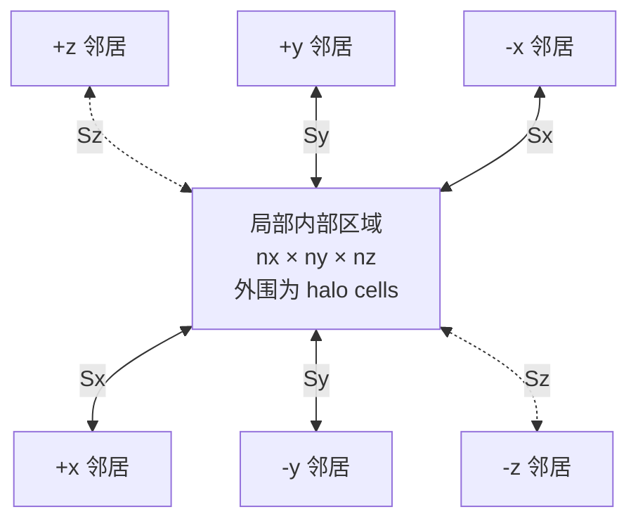

在大规模海洋模型及其他基于网格的科学计算应用中，计算域通常被划分为多个子区域并分配给不同的 MPI 进程。为了保证边界附近数值计算的正确性，相邻进程需要周期性地交换 halo 或 ghost-cell 数据。随着并行规模增加，这类邻域通信可能带来显著的通信与同步开销。非阻塞 MPI 通信为在数据交换期间执行独立计算提供了可能，从而有机会通过通信—计算重叠隐藏部分通信成本。然而，并非所有情况下都能够实现有效的通信—计算重叠。非阻塞通信主要允许通信与计算在逻辑上并发执行，而实际重叠仍取决于 MPI 实现所提供的通信推进机制，并可能随消息大小和底层通信机制而变化（Denis and Trahay, 2016）。

基于这一背景，本文系统研究了三种不同 MPI 实现在通信—计算重叠方面的行为，并分析了多种运行配置对重叠效果的影响。在控制其他变量的条件下，重点比较了不同消息大小对通信重叠能力的影响。此外，实验还考察了是否启用 MPI_Test、是否显式启用异步通信推进机制，以及不同通信传输方式对重叠行为的影响。对于 Intel MPI，本文进一步比较了 TCP 与 verbs 两种通信路径下的性能差异。通过这些对比，本文旨在分析不同 MPI 实现及其运行配置如何影响通信在计算阶段的实际推进程度。

2. Background and Related Work
## 2.1 海洋模型中的通信

海洋环流模型通过数值方法近似计算速度、温度、盐度和海表高度等物理量随时间的演化。这些物理量通常表示在空间网格上，并通过在连续时间步中反复应用数值算子进行更新。提高空间分辨率能够使模型描述更小尺度的海洋过程，但同时也会显著增加计算量和内存需求。因此，大规模海洋模拟通常需要在分布式内存高性能计算系统上运行。

为了将工作负载分配给多个处理器，全局计算域通常被划分为若干较小的子域。每个子域被分配给一个 MPI 进程，由该进程存储和更新相应的模型变量。基于结构化网格的海洋模型通常采用水平方向的区域分解，即沿两个水平方向划分网格，而每个进程保留垂直方向上连续或完整的网格区域。NEMO 和 Parallel Ocean Program（POP）等成熟海洋建模系统均使用了此类区域分解方法 \parencite{madec2024nemo,smith2010pop}。

Poseidon 项目同样面向在规则网格上运行的海洋模拟模型。该项目通过源到源转换支持现代 HPC 架构上的分布式内存并行化和通信优化 \parencite{bremond2024poseidon}。这类模型通常包含 stencil 计算，即一个网格点的更新依赖于其周围网格点的数值。在计算域被分布到多个进程后，部分相邻网格点可能属于其他 MPI 进程。因此，靠近子域边界的计算需要使用相邻子域所拥有的数据。

为了在本地获得这些相邻数据，每个进程会在其局部计算域周围额外存储若干层边界单元。这些附加单元通常称为 halo cells 或 ghost cells。在执行依赖边界区域的数值计算之前，相邻进程必须交换相应的网格数据，这一过程称为 halo exchange。根据区域分解的维度以及所使用的边界条件，每个进程可能需要在一个或多个空间维度的正、负方向上与相邻进程交换数据 \parencite{mittermair2025automatic}。

图示给出了一个局部子域及其在三个空间方向上的相邻 MPI 进程。局部内部区域被 halo cells 包围；每次 halo exchange 将靠近子域表面的数据发送给相应邻居，并接收更新本地 halo 区域所需的数据。图中仅表示进程间的数据依赖关系，不规定消息的实际发送顺序。

**局部子域与六个方向 halo exchange 的概念示意图。** 虚线表示投影到二维图中的 \(z\) 方向；该图根据 Mittermair 等人关于局部区域、halo 和区域分解的示意图重新绘制并扩展为三维情形 \parencite{mittermair2025automatic}。

在许多基于结构化网格的海洋模型中，计算域主要沿两个水平方向进行分解，而每个 MPI 进程通常保留其局部区域内完整的垂直水柱。因此，这类模型中的 halo exchange 主要发生在水平方向，即相邻进程之间交换局部子域边界上的网格数据 \parencite{mittermair2025automatic,smith2010pop}。

通信—计算重叠为降低 halo exchange 的可见成本提供了一种可能的方法。在发起边界数据交换后，进程可以先计算不依赖新 halo 数据的内部网格点，而将靠近子域边界的计算推迟到通信完成之后。如果数据传输能够与内部计算同时推进，则部分甚至全部通信时间可以被有效计算所隐藏。然而，如果通信在这一阶段没有得到推进，那么通信开销只是被推迟到了后续的完成操作中，并没有被真正隐藏。

上述通信模式构成了本文选择 Comb 和 Schweinshaxe 作为 benchmark 的应用背景。两个 benchmark 的具体结构及其在本文实验中的作用将在第 2.4 节和第 2.5 节中分别介绍。

仅使用非阻塞通信函数并不能保证实现有效的通信—计算重叠。实际重叠还取决于 MPI 实现能否在应用程序执行独立计算时持续推进尚未完成的通信操作。决定这一行为的 MPI 通信语义和通信推进机制将在下一节中进行讨论。

2.2 MPI Communication Progress and Overlap

2.2.1 Blocking and Nonblocking Communication

2.2.2 MPI Progress Semantics

* Weak and strong progress
* Progress requirements of nonblocking operations
* Local and remote completion

2.2.3 Polling-Based Progress with MPI_Test

* Periodic polling through MPI_Test
* Communication progress during computation
* Trade-off between progress and polling overhead

2.2.4 Asynchronous Progress Mechanisms

* Progress threads
* Dedicated communication resources
* Hardware-assisted progress and network offload
* Resource contention and runtime overhead

2.3 MPI Implementations and Communication Stacks
    2.3.1 Intel MPI
    2.3.2 Open MPI
    2.3.3 MPICH

2.4 Comb Benchmark
    - 结构化网格与 halo exchange
    - pack、Isend/Irecv、wait、unpack
    - message aggregation
    - Comb 在本论文中的用途

2.5 Schweinshaxe Benchmark
    - benchmark 的目的和工作负载
    - 如何测量 overlap
    - 与 Comb 的互补关系

2.6 Related Work

3. Methodology and Experimental Setup

## 3.1 Benchmarks and Code Modifications

### 3.1.1 Comb

#### Injected Computation

为了在受控条件下研究通信—计算重叠，本文在 Comb 的每个通信周期中加入了一个可调节持续时间的合成计算内核。运行时参数 `-compute_target_us` 以微秒为单位指定目标计算时间，程序将其转换为秒并保存为内部参数。目标值为零时跳过该计算；目标值大于零时，内核持续执行，直到累计测得的计算时间达到或超过目标值。

该内核由一系列具有数据依赖关系的浮点乘加操作组成。每个计算块执行 4096 次迭代，并将结果写入 `volatile` 变量，避免整个计算被编译器删除。每个计算块前后通过 `MPI_Wtime` 测量经过时间，随后将该时间累加并与目标值比较。因此，该方法无需根据特定处理器预先确定固定迭代次数，可以在不同目标时长下生成近似可控的计算窗口。

需要注意的是，`-compute_target_us` 定义的是最小目标时间，而不是精确执行时间。内核只能在完成一个包含 4096 次迭代的计算块后检查终止条件，因此实际时间可能略高于目标值。此外，测得时间包含循环控制和 `MPI_Wtime` 的开销。该内核为单线程串行计算，不使用 OpenMP；其目的不是模拟某个具体海洋算子的数值特征，而是提供可重复调节的计算区间，用于观察不同 MPI 实现和 progress 配置下未完成通信的推进程度。

#### Placement of the Injected Computation

注入计算位于非阻塞通信的启动阶段与完成阶段之间。每个周期首先发布非阻塞接收请求，然后完成发送缓冲区的分配与打包并调用 `MPI_Isend`。在所有发送请求均已发起后，程序执行上述合成计算；计算结束后，再进入接收完成和解包阶段，最后等待发送请求完成。整体执行顺序如下：

这种放置方式形成了一个明确的潜在重叠窗口：通信请求已经启动，但应用线程尚未执行接收或发送完成操作。注入内核内部不调用 `MPI_Test`、`MPI_Wait` 或其他通信完成函数，只使用 `MPI_Wtime` 进行本地计时。因此，计算结束后接收等待时间的减少，反映了未完成通信在该计算窗口内获得的推进；如果通信未在窗口内推进，其成本仍会主要出现在后续完成阶段。具体计时量和 overlap 指标将在第 3.6 节定义。

### 3.1.2 Schweinshaxe

TBD
  
  

3.2 Hardware and Software Environment
    3.2.1 CoolMUC-4

    3.2.2 Compilers
    3.2.3 MPI Implementations
    3.2.4 Build Configuration

3.3 MPI Runtime Configuration
    3.3.1 Communication Stacks and Providers
    3.3.2 Verbs and TCP
    3.3.3 Asynchronous Progress Configuration
    3.3.4 CPU and Rank Binding

3.4 Communication and Progress Variants
    3.4.1 Baseline
    3.4.2 Polling with MPI_Test
    3.4.3 Asynchronous Progress
    3.4.4 wait_all and test_all Completion Variants

## 3.5 Workloads and Experiment Matrix

### 3.5.1 Grid, Ghost Width, and Variables

消息大小扫描采用两个固定的三维全局网格，并通过改变网格变量数量扩大通信负载。所有主扫描实验均设置 `ghost=1_1_1`，即每个空间方向使用一层 ghost cells；同时设置 `periodic=1_1_1`，使三个方向均采用周期边界条件。

第一组实验使用 `grid=8_8_8`，用于覆盖小消息区间。在参考拓扑中，每个 rank 的局部内部网格为 $4\times8\times8$，变量数量设置为

$$
v \in \{1,2,3,4,6,8,10,12\}.
$$

第二组实验使用 `grid=32_32_32`，用于覆盖中等和大消息区间。在参考拓扑中，每个 rank 的局部内部网格为 $16\times32\times32$，变量数量设置为

$$
v \in \{1,2,4,8,16,32,64,128,192,256,336\}.
$$

### 3.5.2 Message Sizes

### 3.5.3 Cycles and Compute Targets

消息大小主扫描执行 100 个通信 cycles，并对每个配置进行 3 次独立运行。每个配置包含成对执行的 `no_midcomm` 和 `midcomm` 两种模式：前者设置 `compute_target_us=0`，用于测量未注入计算时的通信基线；后者在通信启动与完成之间执行合成计算。计算目标并非对所有 MPI 实现和消息大小使用同一个固定值，而是根据对应配置下的基线通信时间分别设置，使注入计算时长与待隐藏的通信时间处于相近量级。

对于 2n2r 配置，计算目标根据各 MPI 实现的实测 `no_midcomm` 基线确定。论文中的重叠分析以实际测得的 `mid-comm` 时间为准，而不是直接将命令行目标值视为精确计算时长。

### 3.5.4 Node Count and Process Topology

实验采用的跨节点进程拓扑 `2n2r_c24` 使用 2 个计算节点，每个节点放置 1 个 MPI rank，共 2 ranks，并采用 `divide=2_1_1`。因此，全局网格仅沿 $x$ 方向划分；在周期边界条件下，$x$ 方向的数据交换发生在两个节点之间，而未分解的 $y$ 和 $z$ 方向产生 MPI self-messages。

3.6 Timing and Evaluation Metrics
    3.6.1 Timing Components and Baselines
    3.6.2 Operational Definition of Overlap
    3.6.3 Overlap Efficiency
    3.6.4 Statistical Aggregation and Variability

3.7 Experimental Procedure
    3.7.1 Warm-up
    3.7.2 Repetitions and Paired Runs
    3.7.3 Execution Order
    3.7.4 Data Filtering
3.8 Reproducibility and Threats to Validity

## 4. Results

结果章节按照实验影响因素组织。每一节均先报告绝对的 `wait-recv`、`mid-comm` 和 `bench-comm` 时间，再讨论 operational overlap rate 与 overall overlap gain，避免仅凭百分比判断性能。

### 4.1 Measurement Validation

#### Open MPI：4.52 MiB 新批次十次测量（2026-09-10）

使用 `run_009_MPIonly` 至 `run_018_MPIonly`，固定旧 baseline 为 2061.891 μs，计算目标为 2061.0 μs。此批改为 **20 cycles、MPI-only**；旧 run_006–run_008 为 100 cycles，不能将新旧差异只归因于重复次数增加。

| Case | 新批次 min / mean / max (%) |
|---|---:|
| 01 | -84.93 / 43.89 / 209.97 |
| 03 | -364.95 / -76.79 / 27.30 |
| 06 | -91.08 / -2.35 / 99.31 |
| 09 | -92.22 / 0.87 / 71.04 |

计算窗口仍约为 2.1 ms，但等待阶段波动很大。Case 03−01 的配对差值均值为 -120.68 pp，范围 -376.69 至 37.00 pp，midcomm 总耗时平均增加 4.95%；Case 09−06 的差值均值为 +3.21 pp，范围 -129.76 至 87.86 pp，总耗时增加 1.14%。异常值均保留，这批数据仍不能证明某种等待方法在该消息点稳定更好。

#### Intel MPI TCP：36.12 KiB 十次复测（2026-09-10）

本点使用 `cm4_inter / 2n2r_c24 / msg_x16KiB_y8KiB_z8KiB` 的 `run_004` 至 `run_013`，每个 `no_midcomm` 与同编号 `midcomm` 配对，统计 MPI backend 的 `seq/seq/seq`。每次 100 cycles，计算目标为 58.0 μs。

固定归一化分母为由原始 Case 06 MPI−Mock 数据核实的 **56.810 μs**。原选定 `run_001` 至 `run_003` 也使用同一分母重新计算。

| Case | 原三次均值 (%) | 复测 min / mean / max (%) | 均值变化 (pp) |
|---|---:|---:|---:|
| 01 | 27.86 | 13.61 / 28.41 / 36.79 | +0.55 |
| 06 | 57.80 | 46.50 / 88.95 / 107.98 | +31.15 |

Case 06 的均值提高，但极差仍为 61.48 pp，不能认为复测后已经稳定。run_009 的 46.50% 和 run_004 的 107.98% 均原样保留。实际计算时间：Case 01 为 59.552–61.921 μs，Case 06 为 59.419–59.613 μs。逐 run 结果见[消息大小影响.md](../../消息大小影响.md)，dashboard 已同步采用这十次复测。

#### Intel MPI TCP：18.06 KiB 十次复测（2026-09-10）

本点使用 `cm4_inter / 2n2r_c24 / msg_x8KiB_y4KiB_z4KiB` 的 `run_007` 至 `run_016`，每个 `no_midcomm` 与同编号 `midcomm` 配对，统计 MPI backend 的 `seq/seq/seq`。每次 100 cycles，计算目标 62.542 μs。

固定分母为旧 Case 06 的 MPI−Mock 通信 baseline **62.542 μs**，已由原始 summary 核实。原选定 `run_004` 至 `run_006` 也用同一分母重新归一化后再比较，避免与按实测计算时间归一化的旧百分比混用。

| Case | 原三次均值 (%) | 复测 min / mean / max (%) | 均值变化 (pp) |
|---|---:|---:|---:|
| 01 | 18.16 | 6.65 / 20.98 / 31.79 | +2.82 |
| 06 | 44.63 | 54.56 / 65.13 / 84.22 | +20.50 |

Case 06 的十次均值明显高于原三次估计，但极差仍有 29.65 pp，不能将这个点描述为定量稳定。实际计算时间：Case 01 为 64.280–66.842 μs，Case 06 为 64.098–64.355 μs。逐 run 结果见[消息大小影响.md](../../消息大小影响.md)，当前 dashboard 已采用这十次复测。

- 验证实际 `mid-comm` 时间与 `compute_target_us` 的关系。
- 验证消息 payload、MPI provider、CPU 绑定和结果文件完整性。
- 比较三次独立运行的波动，并使用 mock 结果识别框架、内存和计时噪声。

### 4.2 Message Size and MPI Implementation

#### 4.2.1 Baseline Communication Time

- 在统一的 2n2r 配置下比较 Intel MPI、Open MPI 和 MPICH 的基线通信时间随消息大小的变化。

#### 4.2.2 Overlap across Message Sizes

- 比较从 1.56 KiB 到 5.93 MiB 的消息扫描。
- 分别讨论插入计算后 `wait-recv` 的缩短量和完整 benchmark 关键路径的变化。

#### 4.2.3 Cross-Implementation Comparison

- 总结三个 MPI 实现在哪些消息区间表现出稳定重叠。
- 由于不同实现并非全部使用相同传输层，不能把所有差异直接归因于 MPI 软件本身。

### 4.3 Effect of the Communication Transport

- 在其他配置相同的条件下比较 Intel MPI verbs 与 Intel MPI TCP。
- Open MPI TCP 和 MPICH TCP 可作为补充背景，但不属于严格的 transport-controlled MPI 实现对比。

### 4.4 Effect of Progress and Completion Mechanisms

#### 4.4.1 Asynchronous Progress

- 比较关闭和开启异步 progress 的结果，同时考虑 progress thread 占用的 CPU 资源。

#### 4.4.2 `wait_all` versus `test_all`

本节区分完成方法与异步 progress 配置。Case 01/03 均关闭 async、配置 24 个 OMP 线程，用于比较 `wait_all` 与 `test_all`；Case 06/09 均开启 async、配置 23 个 OMP 线程，是开启 progress 后的对应对照。Case 03/09 则都使用 `test_all`，变化的是 async 和应用线程预算，不能把这一组的差异归因于等待方法。所有 case 的 receive/send 完成方法一起变化，不能单独归因于接收等待。

统计使用 `cm4_inter / 2n2r_c24`、MPI backend、`seq/seq/seq`，同消息点和同编号 run 配对。采用最新有效 run：12 个复测点中，11 个点各 10 次，Intel MPI TCP 1.56 KiB 排除不可用 `run_007` 后为 9 次；其他点保留原可用 run。Open MPI 4.52 MiB 使用新的 20-cycle MPI-only 批次，不能与旧 100-cycle 批次作严格控制变量比较。复测点用固定旧通信 baseline，原始点用实测 mid-comm 分母。每对 case 使用相同选择与归一化规则，但跨消息点的汇总仅作描述性统计，不是统一物理重叠效率估计。

对每个 run 先计算后一 case 减前一 case 的 overlap 差值，再计算该消息点的均值和 min/max。下表为 19 个消息点均值的中位数，单位为 pp：

| MPI | Case 03−01 | Case 09−06 | Case 09−03 |
|---|---:|---:|---:|
| Open MPI TCP | 0.15 | 0.25 | 6.08 |
| Intel MPI verbs | 1.19 | -3.10 | 69.10 |
| Intel MPI TCP | 0.68 | -0.80 | 62.81 |
| MPICH TCP | 2.64 | 1.46 | 21.48 |

直接比较完成方法时，`test_all` 没有普遍优势。关闭 async 后，四种 MPI 的中位变化都较小；局部改善与退化同时存在，例如 Intel MPI TCP 在 15.62 KiB 提高 13.49 pp，在 12.50 KiB 下降 9.61 pp，这两个点各自的所有配对 run 方向一致。开启 async 后也不存在一致的正向变化。

Case 03/09 的差异主要体现 progress 配置变化，但 overlap 增大不等于总耗时降低。以每个 run 的 `midcomm bench-comm max` 计算 `(B09/B03-1)*100%`，再取消息点均值的中位数，Open MPI、Intel MPI verbs、Intel MPI TCP、MPICH 分别为 -0.42%、+23.25%、-1.62%、+12.87%。这些总时间还包含计算窗口和其他阶段开销，不能解释为单独的 progress-thread 开销。

源码中的 `test_all` 循环发生在注入计算结束后的 `waitRecv` 完成阶段，不能表述为“计算期间持续调用 MPI_Test”。同时 `wait-recv` 包含 unpack 和 buffer 管理，因此差值也不是纯 MPI 等待时间。完成方式应结合等待缩短量、配对波动和总耗时评估。

论文配对差值图：[completion-method-differences.pdf](figures/completion-method-differences.pdf)。误差棒为配对 run 差值的 min/max，不是置信区间。可复算数据见 [completion-paired-points.csv](figures/completion-paired-points.csv)，生成脚本为 [generate_completion_comparison.py](figures/generate_completion_comparison.py)。

### 4.5 Effect of CPU-Resource Configuration

#### 4.5.1 Thread and Progress-Thread Binding

- 比较 progress thread 独占核心、与应用线程共享资源及不同线程数量的结果。

#### 4.5.2 Sequential and OpenMP Execution Policies

- 比较 mesh 和 buffer 阶段使用 sequential 或 OpenMP 策略时的 phase time、overlap 和总时间。

### 4.6 Compute-Window Sensitivity

#### 4.6.1 Compute Duration

- 在补充实验中设置
    $T_{compute}\in\{0.25T_{comm},0.5T_{comm},T_{comm},2T_{comm}\}$，研究计算窗口长度与通信隐藏量、资源竞争及整体收益之间的 trade-off。
- 该节只有在对应数据完成后才能作为正式结果；当前主扫描为每个配置选择一个与通信时间接近的目标。

#### 4.6.2 Placement of Independent Computation

- 若完成 precompute 实验，则比较不同计算放置位置；它与主实验中位于 `post-send` 和 `wait-recv` 之间的 `mid-comm` 窗口应分开讨论。

### 4.7 Cycle Count and Warm-up Sensitivity

- 比较不同 cycles 时必须保持消息大小、MPI 配置和计算目标一致。
- Comb 在正式计时前执行 $\max(1,\lfloor cycles/10\rfloor)$ 个 correctness cycles。改变 cycles 也会改变正式测试前通信路径被执行的次数，因此需要同时报告这一因素。

### 4.8 Summary of Results

- 汇总哪些因素能够稳定减少 exposed `wait-recv`，哪些因素能够改善完整 benchmark 的关键路径。
- 将可重复趋势与只在个别运行中出现的异常峰值明确区分。
